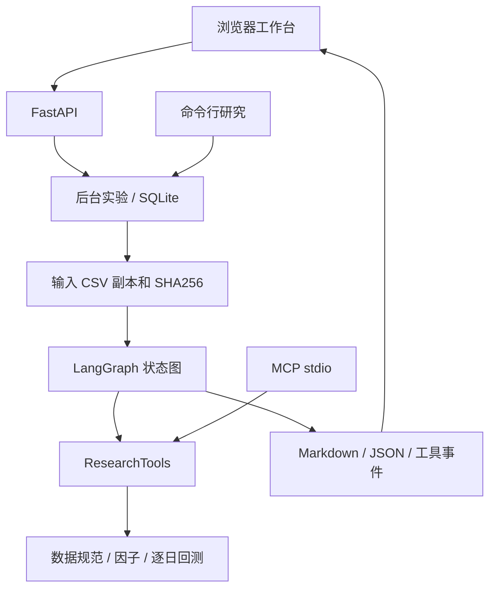
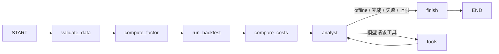

# 第二阶段架构与二开说明

上游基线：`virattt/ai-hedge-fund`，commit `78b779c1389e2d1452dc29606d2c4126d859b964`。保留原 MIT License。新增模块属于自有实现，原美股 pipeline 没有被描述为已完整支持 A 股。新增研究引擎主要用于演示 Agent 应用工程与回测审计。

## 状态图

必跑节点构成可信证据管线。可选模型只补充研究查询和分析文字，回测结果保存在独立 `backtest` state 字段，不会被模型输出替换。工具名称来自白名单，所有模型调用的数据集被绑定到本实验副本。离线模式没有 LLM，不把固定状态图节点称作自主推理。

## 可审计性

- JSON 包含请求、引擎版本、数据哈希、质量摘要、因子快照、成本对照、逐日净值、信号、成交、未成交和期末持仓。
- SQLite 保存实验状态和逐节点事件；报告存为独立文件。
- 实验使用数据副本；MCP 单次调用读取当前数据文件，返回的是当前版本结果。
- 模型失败显式记录 `llm_error` 和 `analysis_source=offline`，不会吞掉数据基础设施错误。
- 统计数据仅由确定性计算产生，模型文字和事实证据在结果结构中分开。

## 第一阶段问题修正

原回测构造 `picks` 时检查未来退出日价格和成交量，随后按可退出股票重新等权，导致未来信息进入买入。新引擎改成交易日事件账本，买入时只读信号证据、当日开盘和日线成交近似；退出时才检查当日收盘成交条件。日线成交量仍是全天汇总，开盘成交假设与流动性约束属于明确简化，不能据此声称有盘中实盘级别的无偏成交模型。

未来价格和退出行情缺失的测试锁定过去信号、买入与净值，卖出受阻测试锁定持仓不会消失。不同引擎版本的报告指标不可直接当作完全同口径历史结果比较。

## 工程取舍

MVP 使用同源静态页面，不需 Node/npm。采用单进程线程队列而非 Redis/Celery，便于本地运行；SQLite 用事务保存任务。没有分布式锁、云部署、鉴权服务、持久 LangGraph checkpoint 或生产级交易能力。下一阶段可增加样本外评估、两份 Skill、Docker 和更完善的队列，再按实习岗位要求取舍。
